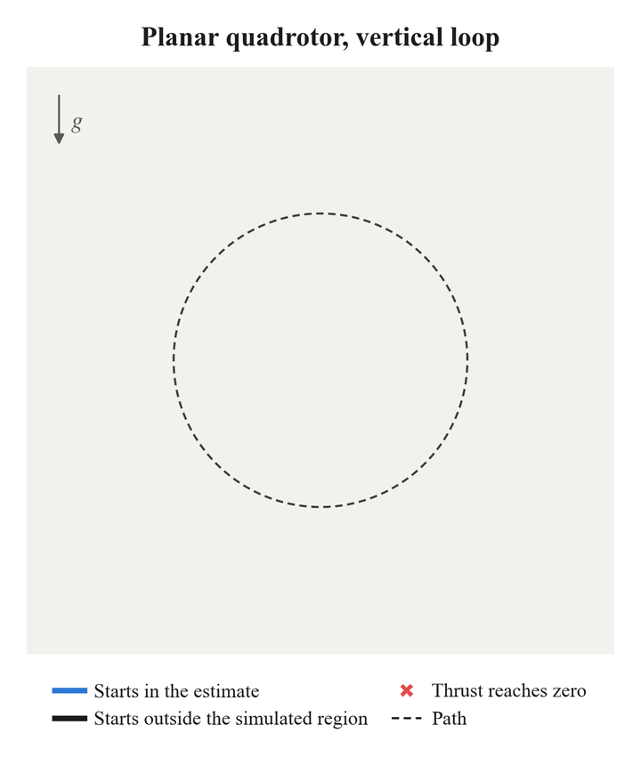
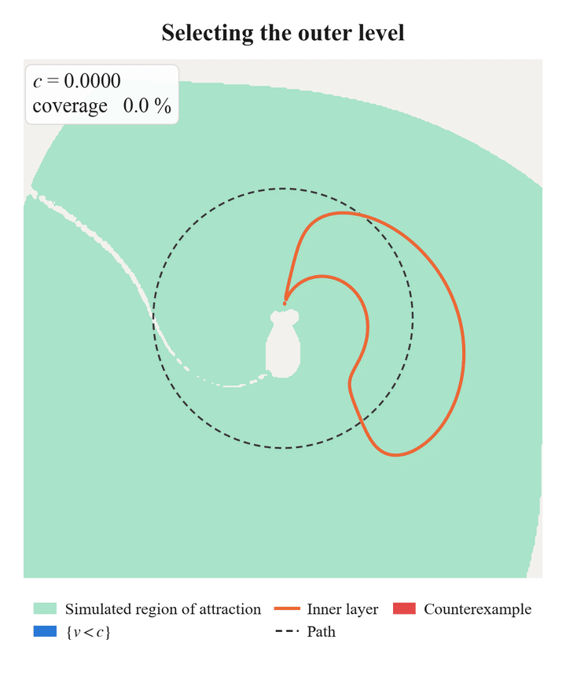

# Learning Regions of Attraction for Transverse Feedback Linearization under Controller Singularities

Abdullah Waqar Malik, Hamza Tariq, Adeel Akhtar

Paper under review. Project page: https://gradslab.github.io/roa_tfl/

<p align="center">


</p>
<p align="center">

</p>

This repository estimates the constrained region of attraction of a fixed closed loop: the initial states whose
trajectories reach a target set while they stay off the singular set of the controller and inside the state constraints.
For a transverse feedback linearization (TFL) controller, the state-constrained Zubov value function splits into a known
quadratic cost-to-go and a safety value function, and only the safety value function is learned.
The estimate has two layers: an inner layer verified by interval branch and bound, and an outer layer tested on
samples with a finite-step decrease condition and a scenario bound.
The cases are a unicycle on a circle and on a sinusoid and a planar quadrotor, plus nine equilibrium benchmarks with
their baselines.
Every number, table and figure of the paper is produced by the scripts here, and the stored runs reproduce them
without retraining.

## Layout

```
roa_tfl/
├── reproduce.sh          entry point (setup, tables, figure, paper, tfl, benchmarks, all)
├── requirements.txt      pinned Python packages
├── tfl/                  TFL cases: circle, sinusoid, quadrotor
│   ├── problem.py        state-constrained Zubov problem of a TFL loop
│   ├── quad_system.py    planar quadrotor TFL loop
│   ├── unicycle/         unicycle TFL loop (tfl_system.py)
│   ├── formal/           symbolic loop and affine arithmetic for inner_region.py
│   ├── inner_region.py   interval verification of the inner layer
│   ├── zpinn*.py         candidate and baselines (zpinn_liu.py: Zubov PINN and quadratic baseline; zpinn_dz.py: Dirichlet-Zubov PINN; zpinn_whole.py: no decomposition)
│   ├── certify3.py       level selection and final test
│   ├── repair3.py        counterexample-guided fine-tuning
│   ├── run_probes.sh     seed-0 configuration runs of Appendix G
│   ├── run_*.sh          per-case pipelines
│   ├── make_results3.py  ledger: writes paper/results3.tex and paper/table_*3.tex
│   ├── figs3.py          Figure 1
│   ├── runs/             stored runs (configs, histories, test results and, except for the configuration runs, networks)
│   └── results/          stored results and reference simulations
├── benchmarks/           nine equilibrium benchmarks, their verified inner layers and baselines
│   ├── run_bench.sh, run_obs.sh, run_sos_study.sh
│   ├── runs/             stored runs
│   └── results/          stored results, reference simulations and baseline networks
├── paper/                LaTeX sources, generated tables, Figure 1 and build.sh
│   └── reference/        committed copy of the generated files, for checking
├── docs/                 project page
├── web/                  data export for the project page
└── render/               animations
```

## Reproduce

Python 3.12 on a CPU. The stored runs reproduce every table and figure without a GPU.

| Command | What it does | Time |
|---|---|---|
| `./reproduce.sh setup` | `pip install -r requirements.txt` | a few minutes |
| `./reproduce.sh tables` | runs `tfl/make_results3.py` from the stored runs and compares every generated file with `paper/reference/`; prints OK or the differences | about 1 s |
| `./reproduce.sh figure` | runs `tfl/figs3.py` (Figure 1) with the cached slice simulations in `tfl/results/` | about 30 s |
| `./reproduce.sh paper` | builds `paper/main.pdf` with `latexmk` | about 5 s |
| `./reproduce.sh tfl` | full TFL pipeline: inner layers, the seed-0 configuration runs (`run_probes.sh`), then per case `run_stream.sh`, `run_pinn2.sh`, `run_dz.sh`, `run_dz2.sh`, `run_rich.sh`, then the oracle level of the PINN baselines, the reference sensitivity, the floor share and the test of unsafe states | hours on a laptop CPU |
| `./reproduce.sh benchmarks` | full benchmark pipeline: reference simulations, `run_bench.sh`, `run_obs.sh`, baselines, verified inner layers, rescoring, test of unsafe states, sum-of-squares baselines and `run_sos_study.sh` | hours on a laptop CPU |
| `python web/export_results.py` | numbers of the project page, from `paper/results3.tex` and the generated tables | about 1 s |
| `python web/export_slices.py` | slice data of the interactive maps of the project page | about 30 min |
| `python render/<name>.py` | the animations in `docs/assets/media/` (see `render/README.md`) | minutes each |
| `./reproduce.sh all` | `benchmarks`, `tfl`, `figure`, `tables`, `paper` | hours on a laptop CPU |

Known times of single steps: inner layer 110 to 3626 s per case, training 15 to 27 min per seed (seeds 1 to 3), level selection
1 to 5 min per run, fine-tuning 1 to 16 min per run.

`tfl` and `benchmarks` start from scratch. They move the stored `runs/` and `results/` of that folder to
`runs.stored/` and `results.stored/` first. `tfl/results/inner_contact.json` holds the sampled first-contact levels
printed by `inner_region.py`; it is copied back from the stored results. A rerun gives close but not identical
numbers, since training is not bitwise reproducible across machines. The ledger asserts every comparative claim of the
paper (for example which method covers the most) and stops if a rerun changes one.

## Where each result comes from

All numbers pass through `tfl/make_results3.py`, which reads `tfl/runs/`, `tfl/results/`, `benchmarks/runs/` and
`benchmarks/results/`.

| Paper item | Produced by |
|---|---|
| Table 1, coverage on the TFL cases | `tfl/run_stream.sh` (`zpinn.py`, `certify3.py`, `repair3.py`, `union3.py`, `ceiling3.py`, `zpinn_whole.py`), `run_pinn2.sh`, `run_dz.sh`, `run_dz2.sh` |
| Figure 1, slices | `tfl/figs3.py` |
| Table 2, constants | `tfl/problem.py`, stored by `inner_region.py` in `tfl/results/inner_<case>.json` |
| Table 3, equilibrium benchmarks (Appendix D) | `benchmarks/run_bench.sh`, `run_obs.sh`, `baselines.py`, `baseline_pinn2.py`, `baseline_dz.py`, `certify_core.py --relaxed`, `reselect.py`, `sos.py`, `sos_sound.py`, `sos_settings.py` |
| Table 4, verified inner layers (TFL) | `tfl/inner_region.py` |
| Table 5, verified inner layers (benchmarks) | `benchmarks/core_proof.py` |
| Table 6, configuration | written by hand in `paper/table_config3.tex`; the flags are in `tfl/run_stream.sh` |
| Appendix G, choice of the loss weights | `tfl/run_probes.sh` |
| Table 7, per-seed results | `tfl/certify3.py`, `tfl/repair3.py` |
| Table 8, ablations | ablation block of `tfl/run_stream.sh`, `tfl/certify3.py` |
| Theorem 3, two-layer estimate | inner layer: `tfl/inner_region.py`; outer layer: `tfl/certify3.py` |
| Proposition 4, scenario bound | final test in `tfl/certify3.py` and `benchmarks/iid.py`, `benchmarks/certify_core.py` |
| Proposition 5, unsafe states | `tfl/unsafe3.py`, `tfl/unsafe_check3.py`, `benchmarks/unsafe_bench.py`, `benchmarks/unsafe_bench_check.py` |
| Proposition 6, two-layer estimate for an equilibrium (Appendix D) | `benchmarks/core_proof.py`, `benchmarks/certify_core.py --relaxed` |
| Oracle level of the PINN baselines on the TFL cases | `tfl/oracle_tfl.py` |
| Reference sensitivity and floor share | `tfl/ref_sensitivity.py`, `tfl/floor3.py` |
| Box and obstacle effect on the obstacle benchmarks | `benchmarks/box_effect.py` |
| Sum-of-squares settings on Van der Pol | `benchmarks/run_sos_study.sh`, `benchmarks/sos_vdp_study.py` |

Lemma 1 and Theorem 2 are proved in the appendix and need no computation.

## Names in the code

| Code | Paper |
|---|---|
| `alpha` | cost scale γ |
| `q_ex`, `q_exact` | quadratic cost-to-go |
| `psi`, `Phi`, `Psi` | margin function ψ, safety value function Φ, network part Ψ_θ |
| `c_inner`, `c_I` | level of the verified inner layer |
| `repair` | counterexample-guided fine-tuning |
| `w_cap` | V_max of the exponential loss weight |
| `circ3`, `sin6`, `quad3` | circle, sinusoid, quadrotor |

## Citation

```bibtex
@unpublished{malik2027constrained,
  title  = {Learning Regions of Attraction for Transverse Feedback Linearization under Controller Singularities},
  author = {Malik, Abdullah Waqar and Tariq, Hamza and Akhtar, Adeel},
  note   = {Under review},
  year   = {2027}
}
```

## License

License to be decided.
