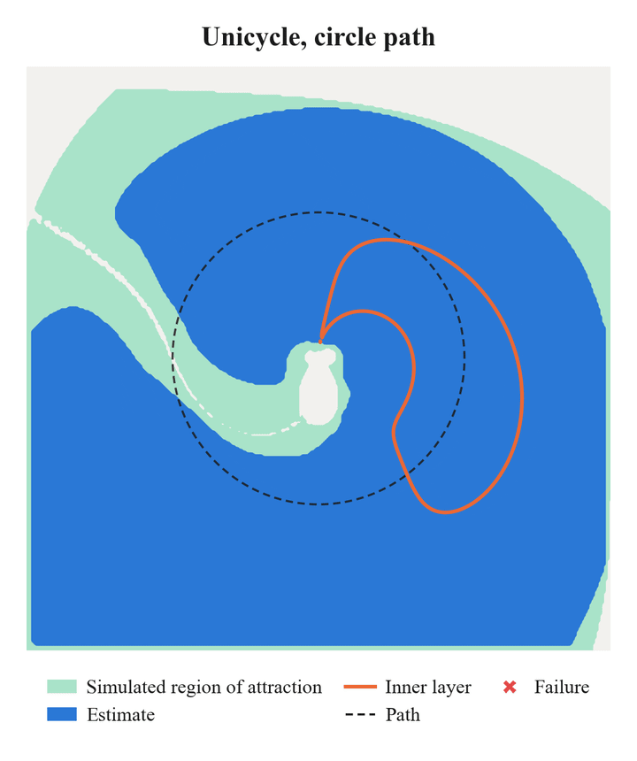

# Learning Regions of Attraction for Transverse Feedback Linearization under Controller Singularities

Abdullah Waqar Malik, Hamza Tariq, Adeel Akhtar

Paper under review. Project page: https://gradslab.github.io/roa_tfl/

<p align="center">


</p>
<p align="center">

</p>

This repository estimates the constrained region of attraction of a transverse feedback linearization (TFL) closed
loop: the initial states from which the closed loop converges to the path without violating the state constraints or
the regularity constraints of the controller.
On the admissible set the error dynamics are exactly linear, so this region is the largest forward invariant subset of
the admissible set, and its state-constrained Zubov value function splits into a known quadratic cost-to-go and a
safety value function. Only the safety value function is learned, by fitted value iteration without infinite-horizon
trajectory labels.
The estimate has two layers: an inner layer verified by interval branch and bound, and a learned outer layer tested on
samples with a finite-step decrease condition and a scenario bound.
The candidate is trained with one of two step settings, a long or a short step of the value iteration. A rule that
uses no reference labels keeps one setting per system, decided on seed 0.
The cases are a unicycle on a circle and on a sinusoid and a planar quadrotor. The same algorithm is also run on seed 0
of five closed loops with an equilibrium.
Every number, table and figure of the paper is produced by the scripts here, and the stored runs reproduce them
without retraining.

## Layout

```
roa_tfl/
├── reproduce.sh          entry point (setup, tables, figure, paper, tfl, benchmarks, all)
├── requirements.txt      pinned Python packages
├── tfl/                  TFL cases: circle, sinusoid, quadrotor
│   ├── problem.py        state-constrained Zubov problem of a TFL loop
│   ├── quad_system.py    planar quadrotor TFL loop
│   ├── unicycle/         unicycle TFL loop (tfl_system.py)
│   ├── formal/           symbolic loop and affine arithmetic for inner_region.py
│   ├── inner_region.py   interval verification of the inner layer
│   ├── zpinn*.py         candidate and baselines (zpinn_liu.py: Zubov PINN and quadratic baseline; zpinn_dz.py: Dirichlet-Zubov PINN; zpinn_whole.py: no decomposition and safety value)
│   ├── certify3.py       level selection and final test
│   ├── repair3.py        counterexample-guided fine-tuning
│   ├── carry_level3.py   level of a network that fine-tuning leaves unchanged: the lower of its two final tests
│   ├── union3.py         per-seed summary and union of the four estimates
│   ├── run_stream.sh     pipeline of one case (both step settings on seed 0, four seeds, baselines, ablations)
│   ├── run_*.sh          PINN baselines of one case
│   ├── make_results3.py  ledger: writes paper/results3.tex and the generated paper/table_*3.tex
│   ├── figs3.py          Figure 1
│   ├── runs/             stored runs of the long-step setting and of the baselines (configs, histories, test results, networks)
│   ├── runs_short_seed0/ seed 0 of the short-step setting (config and test result)
│   └── results/          stored results and reference simulations
├── benchmarks/           five closed loops with an equilibrium, seed 0 with both step settings
│   ├── systems.py, core.py, certify.py, repair.py, gt.py, iid.py
│   ├── step_rule.py      step setting of each system
│   ├── run_bench.sh      pipeline of the five systems
│   ├── runs/             stored seed-0 runs of the short-step setting
│   ├── runs_long_seed0/  stored seed-0 runs of the long-step setting
│   └── results/          reference simulations and results/step_rule.json
├── paper/                LaTeX sources, generated tables, Figure 1 and build.sh
│   └── reference/        committed copy of the generated files, for checking
├── docs/                 project page
├── web/                  data export for the project page
└── render/               animations
```

## Reproduce

Python 3.12 on a CPU. The stored runs reproduce every table and figure without a GPU.

| Command | What it does | Time |
|---|---|---|
| `./reproduce.sh setup` | `pip install -r requirements.txt` | a few minutes |
| `./reproduce.sh tables` | runs `tfl/make_results3.py` from the stored runs and compares every generated file with `paper/reference/`; prints OK or the differences | about 1 s |
| `./reproduce.sh figure` | runs `tfl/figs3.py` (Figure 1) with the cached slice simulations in `tfl/results/` | about 30 s |
| `./reproduce.sh paper` | builds `paper/main.pdf` with `latexmk` | about 5 s |
| `./reproduce.sh tfl` | full TFL pipeline: inner layers, then per case `run_stream.sh`, `run_pinn2.sh`, `run_dz.sh`, `run_dz2.sh`, `run_rich.sh`, then the oracle level of the PINN baselines, the reference sensitivity, the share excluded by the quadratic bound and the test of unsafe states | three to four days on a laptop CPU |
| `./reproduce.sh benchmarks` | reference simulations of the five systems, then `run_bench.sh`: seed 0 with both step settings, level selection, fine-tuning, and `step_rule.py` | three to four hours on a laptop CPU |
| `python web/export_results.py` | numbers of the project page, from `paper/results3.tex` and the generated tables | about 1 s |
| `python web/export_slices.py` | slice data of the interactive maps of the project page | about 30 min |
| `python render/<name>.py` | the animations in `docs/assets/media/` (see `render/README.md`) | minutes each |
| `./reproduce.sh all` | `benchmarks`, `tfl`, `figure`, `tables`, `paper` | three to four days on a laptop CPU |

Known times of single steps on the TFL cases, measured with eight trainings running at once on one thread each: inner
layer 110 to 3626 s per case, training 44 to 73 min per seed with the long step, level selection 1 to 13 min per
fine-tuned run, fine-tuning 2 to 59 min per run, test of unsafe states 5 to 17 min per case (1 to 4 min on an idle
machine). The stored trainings, level selections and fine-tunings of the long-step runs add up to about 75 hours. On
the benchmarks a training takes 3 to 6 min with the short step and 17 to 26 min with the long step.

`tfl` and `benchmarks` start from scratch. They first move the stored run and result folders of that part
(`runs/`, `results/`, and `runs_short_seed0/` or `runs_long_seed0/`) to folders with the suffix `.stored`.
`tfl/results/inner_contact.json` holds the sampled first-contact levels printed by `inner_region.py`; it is copied back
from the stored results. A rerun gives close but not identical numbers, since training is not bitwise reproducible
across machines. The ledger stops if a rerun changes one of the claims it checks: the step setting that each system
keeps, that the share of box samples and the coverage rank the two settings alike, that the PINN baselines cover less
than the candidate even at their oracle level, and that no reference state lies inside a kept benchmark estimate and
outside the simulated region of attraction. It also checks that the reported TFL runs were trained with the long-step
setting and that each summary agrees with the test results of its runs.

The stored runs hold the selected snapshot of each network. `tfl/oracle_tfl.py` scans every snapshot of the PINN
baselines, so its stored result `tfl/results/oracle_tfl.json` is reproduced only after `./reproduce.sh tfl`. Likewise,
`tfl/ablation_summary3.py` reads the file time of each trained `model.pt`, which is not stored, so it runs only after
a rerun.

## The two step settings

| Setting | Flags of `tfl/zpinn.py` and `benchmarks/core.py` | Meaning |
|---|---|---|
| long | `--tau 2.0 --sub 80 --gamma-num 1 --w-exit 10` | step 2 of the value iteration in normalized time (80 RK4 substeps), cost scale γ = 1/q90, exit weight 10 |
| short | the defaults | step 0.2 (8 RK4 substeps), γ = 3/q90, no exit weight |

On seed 0, each setting is trained and passes level selection and the final test (`certify3.py --top 3` on the TFL
cases, `certify.py` on the benchmarks, whose last test draws an independent set of box, face and constraint samples in
place of the uniform box samples of the TFL cases). The setting whose estimate holds the larger share of box samples before
fine-tuning (`region_fraction_of_box`, on the benchmarks `box_volume`) is kept for all seeds. This uses no reference
labels. The three TFL cases keep the long step (`tfl/runs_short_seed0/` holds the short-step seed 0). Of the five
benchmarks, the pendulum and the 3-D system keep the long step and the others the short step
(`benchmarks/results/step_rule.json`).

`tfl/run_stream.sh` trains seed 0 with both settings and the four reported seeds with the long step. The ledger stops
if the rule would keep the short step on a TFL case. The stored runs in `tfl/runs_short_seed0/` were trained when the
short-step setting was chosen, before the flags `--gamma-num` and `--w-exit` existed. Their `config.json` therefore has
neither key and keeps the output name of that time in `out`, and their `certify_v3.json` names the run `runs/<name>_s0`.

## Where each result comes from

All numbers pass through `tfl/make_results3.py`, which reads `tfl/runs/`, `tfl/runs_short_seed0/`, `tfl/results/`,
`benchmarks/runs/`, `benchmarks/runs_long_seed0/` and `benchmarks/results/step_rule.json`.

| Paper item | Produced by |
|---|---|
| Algorithm 1 | `tfl/run_stream.sh` (`zpinn.py`, `certify3.py`, `repair3.py`, `carry_level3.py`), `benchmarks/run_bench.sh` |
| Table 1, coverage on the TFL cases | `tfl/run_stream.sh` (`zpinn.py`, `certify3.py`, `repair3.py`, `carry_level3.py`, `union3.py`, `ceiling3.py`, `zpinn_whole.py`), `run_pinn2.sh`, `run_dz.sh`, `run_dz2.sh` |
| Figure 1, slices | `tfl/figs3.py` |
| Table 2, constants (Appendix B) | `tfl/problem.py`, stored by `inner_region.py` in `tfl/results/inner_<case>.json` for γ = 3/q90; the ledger divides γ by 3 for the long-step setting |
| Table 3, step setting on seed 0 (Appendix D) | TFL rows: `tfl/run_stream.sh` (`runs_short_seed0/` and seed 0 of `runs/`); other rows: `benchmarks/run_bench.sh`, `benchmarks/step_rule.py` |
| Table 4, verified inner layers (Appendix E) | `tfl/inner_region.py`, verified for γ = 3/q90; the ledger divides the levels by 3 for the long-step setting, which describes the same sets |
| Tables 5 and 6, configuration (Appendix F) | written by hand in `paper/table_config3.tex` and `paper/table_config3b.tex`; the flags are in `tfl/run_stream.sh` |
| Table 7, per-seed results (Appendix G) | `tfl/certify3.py`, `tfl/repair3.py`, `tfl/carry_level3.py` |
| Table 8, ablations (Appendix G) | ablation block of `tfl/run_stream.sh`, `tfl/certify3.py`, `tfl/ablation_summary3.py` |
| Theorem 3, two-layer estimate | inner layer: `tfl/inner_region.py`; outer layer: `tfl/certify3.py` |
| Proposition 4, scenario bound (Appendix C) | final test in `tfl/certify3.py` (`benchmarks/iid.py`) |
| Proposition 5, unsafe states (Appendix C) | `tfl/unsafe3.py`, `tfl/unsafe_check3.py` |
| Scale search, larger PINNs and oracle level of the PINN baselines (Appendix D) | `tfl/run_pinn2.sh`, `run_dz.sh`, `run_dz2.sh`, `run_rich.sh`, `tfl/oracle_tfl.py` |
| No-decomposition and safety-value baselines (Appendix D) | `tfl/zpinn_whole.py` (safety value: `ZW_NO_COST=1`) |
| Closed loops with an equilibrium (Appendix D) | `benchmarks/run_bench.sh` |
| What limits the outer and the inner layer (Appendix G) | `tfl/ceiling3.py`, `tfl/floor3.py`, `tfl/inner_region.py` (`tfl/results/inner_contact.json`) |
| Sensitivity of the reference labels to the integration step (Appendix G) | `tfl/ref_sensitivity.py` |

Lemma 1 and Theorem 2 are proved in the appendix and need no computation.

## Names in the code

| Code | Paper |
|---|---|
| `alpha` | cost scale γ |
| `gamma_num` | numerator of the cost scale, γ = `gamma_num` / q90 |
| `tau`, `sub` | step τ of the value iteration and its RK4 substeps |
| `w_exit` | exit weight w_ex |
| `q_ex`, `q_exact` | quadratic cost-to-go |
| `psi`, `Phi`, `Psi` | margin function ψ, safety value function Φ, network part Ψ_θ |
| `c_inner`, `c_I` | level of the verified inner layer |
| `repair`, `_rep3`, `_rep` | counterexample-guided fine-tuning and its runs |
| `w_cap` | V_max of the exponential loss weight |
| `whole`, `<name>w` | no-decomposition baseline |
| `abl_safety_value` | safety-value baseline |
| `ceiling` | exact value function cut at the level of the candidate |
| `circ3`, `sin6`, `quad3` | circle, sinusoid, quadrotor |
| `vdp`, `vdp3`, `pendulum`, `con3d`, `power` | Van der Pol with μ = 1 and μ = 3, pendulum, 3-D system, power system |

## Citation

```bibtex
@unpublished{malik2027constrained,
  title  = {Learning Regions of Attraction for Transverse Feedback Linearization under Controller Singularities},
  author = {Malik, Abdullah Waqar and Tariq, Hamza and Akhtar, Adeel},
  note   = {Under review},
  year   = {2027}
}
```

## License

License to be decided.
